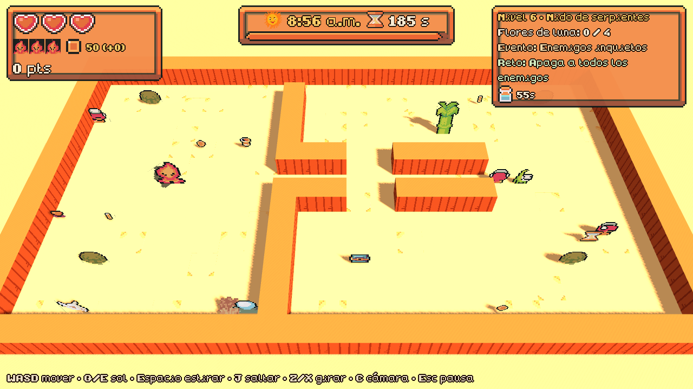

# HORA DORADA · Versión beta (Godot 4.7)

> **Mueve el sol. Mueve tu sombra.**

Rompecabezas en **3D** hecho con el motor **Godot 4.7** y sprites pixel art reales del paquete gratuito
**Ninja Adventure** (CC0). Eres **Gno**, el espíritu de un reloj de sol del desierto de Sonora: con la arena
de tu reloj mueves el sol, y tu sombra abre las **flores de luna**, activa placas y apaga a los enemigos.

| | |
|---|---|
| **Escuela / grupo** | Universidad Tecnológica de Hermosillo (UTH) · IDGS 8-2 |
| **Equipo** | Joel Armando Ibarra Rubalcava · Jorge Humberto Martínez Delgado |
| **Versión** | 0.9.0-beta |
| **Motor** | Godot Engine 4.7.2 (GDScript, renderizador GL Compatibility) |
| **Caso práctico** | El GDD de Hora Dorada (repositorio [`hora-dorada`](https://github.com/joeljorex/hora-dorada)) |



## ▶️ Cómo jugar la beta

- **Sin instalar nada:** abre `build/HoraDorada_Beta.exe` (Windows 10/11, 64 bits).
- **Con Godot 4.7:** abre `project.godot` en Godot y presiona **F5**.

| Acción | Teclado | Control |
|---|---|---|
| Caminar | `W A S D` / flechas | Palanca izquierda |
| Regresar / adelantar el sol | `Q` / `E` | LB / RB |
| Estirarse (sombra más larga) | `Espacio` | X |
| Saltar | `J` / `Shift` | A |
| Girar la cámara 90° | `Z` / `X` | Cruceta ← / → |
| Cámara alta | `C` | — |
| Pausa / reiniciar | `Esc` o `P` / `R` | Start |
| Pantalla completa | `F11` | — |

## ✅ Lo que pide la tarea y dónde está

| Requisito | Cómo está en el juego | Código |
|---|---|---|
| **Eventos** | Bus de eventos con 26 señales (flor abierta, golpe, compra, evento del nivel…). Cada intento trae un **evento aleatorio**: Brisa del desierto (nubes que quitan la sombra), Día veloz, Lluvia de ventajas, Tesoro de arena o Enemigos inquietos. | `scripts/autoload/eventos.gd`, `scripts/nivel.gd` |
| **Comportamientos** | **Destello**: patrulla y se da la vuelta al chocar. **Serpiente**: deambula, persigue con A* (`AStarGrid2D`) y huye de la sombra. **Lagartija**: vigila, se prepara, embiste en línea recta, se cansa y regresa a su puesto. **Piloto automático** de la demo. | `scripts/actores/*.gd`, `scripts/piloto.gd` |
| **Transacciones** | **Mercado del reloj**: comprar con monedas de sol. Cada compra valida el saldo, descuenta, entrega, queda en el **historial** (folio, fecha, monto y saldo) y se guarda; si el guardado falla, se revierte. Al ganar, las monedas se depositan como ingreso. | `scripts/autoload/juego.gd`, `scripts/mercado.gd` |
| **Acciones** | Caminar, saltar, estirarse, mover el sol, girar la cámara, cámara alta, pausar, reiniciar. Acciones del `InputMap` (teclado y control). | `scripts/actores/gno.gd`, `juego.gd` |
| **Colisiones** | `CharacterBody3D` contra `StaticBody3D` (muros, plantas, rocas, puertas). `Area3D` para monedas, cofre, relojes, ventajas, salida y el choque con enemigos. Capas: 1 mundo, 2 jugador, 3 enemigos. | `scripts/mundo/mundo.gd`, `scripts/actores/enemigo.gd` |
| **Puntaje** | Flor 100, destello 50, serpiente 75, lagartija 100, moneda 10, ventaja 50, golpe −50. Bonos al ganar (corazones, arena, rapidez, reto), multiplicador del evento, **1 a 3 estrellas** y récord por nivel. | `scripts/logica/puntaje.gd` |
| **Oportunidades / vidas** | **3 corazones** por nivel y **3 oportunidades** por partida. Perder (sin corazones, sin arena o de noche) cuesta una oportunidad; con 0 se acaba la partida. Se pueden comprar corazón extra y oportunidad extra. | `scripts/nivel.gd`, `juego.gd` |
| **Demo (animatronic)** | **Modo DEMO**: el juego se juega solo (piloto automático con A*). Se abre con *Ver la demo* o solo, tras 25 s sin tocar nada en el menú. | `scripts/piloto.gd`, `scripts/menu.gd` |

## 🧪 Pruebas

```
Godot_v4.7.2-stable_win64_console.exe --headless --path . -- --pruebas
```

Corre **88 pruebas** (unitarias y de integración con el juego real) y deja el resultado en
[`pruebas/resultados.md`](pruebas/resultados.md). Las capturas se regeneran con `-- --capturas` (con ventana).

## 📂 Estructura

```
escenas/          menu.tscn, nivel.tscn, mercado.tscn
scripts/
  autoload/       eventos.gd (bus), juego.gd (estado, tienda, guardado), sonido.gd
  logica/         sombras.gd, puntaje.gd, niveles.gd
  mundo/          mundo.gd (arma el desierto 3D), efectos.gd
  actores/        gno.gd, enemigo.gd, destello.gd, serpiente.gd, lagartija.gd
  ui/             tema.gd, hud.gd
  nivel.gd, menu.gd, mercado.gd, piloto.gd
assets/           sprites, audio y fuente (ver CREDITOS.md)
pruebas/          pruebas.gd y resultados
herramientas/     copiar_recursos.py, completar_fuente.py, capturador.gd
docs/             manual, reporte de pruebas, portafolio y capturas
build/            HoraDorada_Beta.exe
```

## 🎨 Créditos

Arte, música y efectos: **Ninja Adventure Asset Pack** (Pixel-boy y AAA, CC0). Detalle en
[`assets/CREDITOS.md`](assets/CREDITOS.md).
